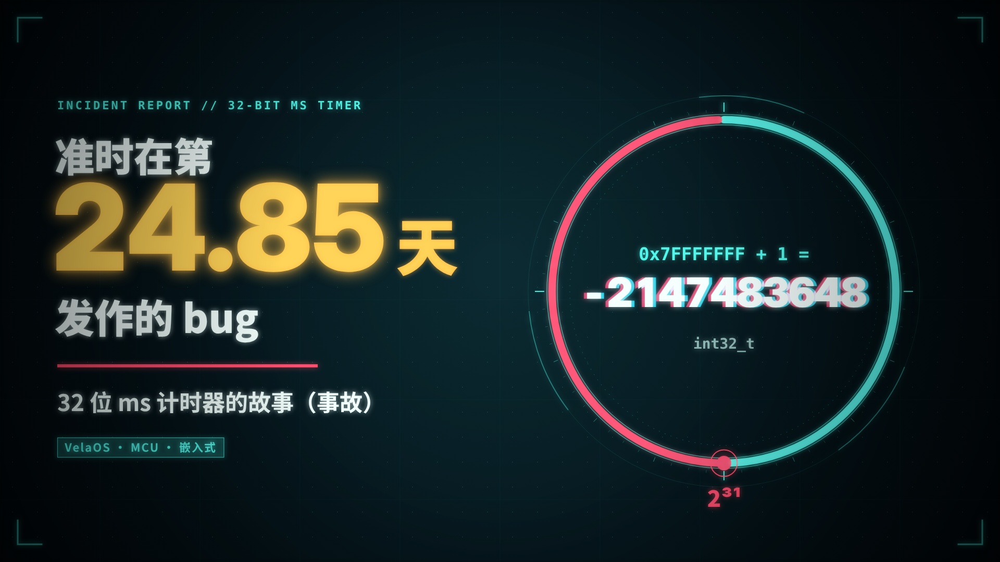
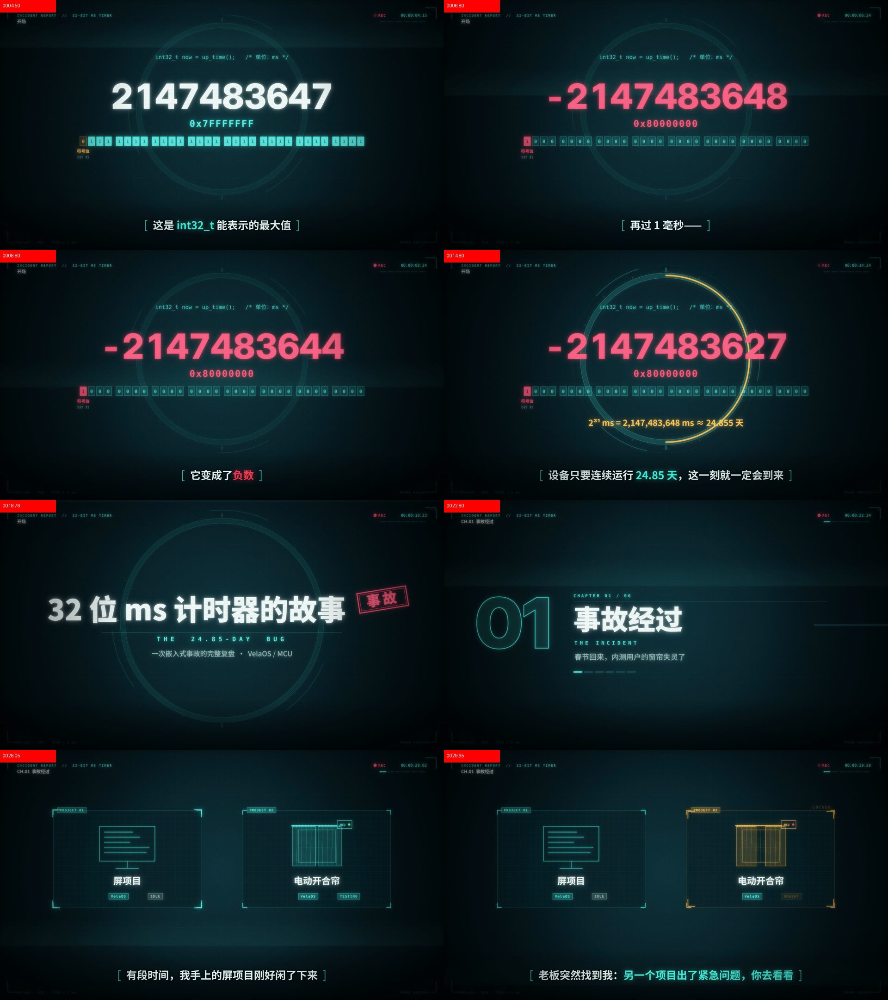

# 32 位 ms 计时器的故事（事故）

- B 站：（发布后补上链接）
- 时长：5 分 56 秒 · 3840×2160 · 30fps
- 风格：赛博朋克 HUD，参考了 B 站视频[《盘点opus5.5做视频达到商业水准的15种风格》](https://www.bilibili.com/video/BV1JvaW6JEMb/)里的第 08 种
- 画面、配乐、音效都由 AI 写代码生成；没有配音，靠画面字幕讲故事

## 讲了什么

春节回来，内测用户的电动窗帘怎么按遥控器都没反应，只能重启。原因是 32 位毫秒计时器的回绕：`up_time()` 缺了函数声明，返回值被当成 `int` 接住；项目里又到处直接用 `now > deadline` 比大小。计时器走到 2³¹ ms（约 24.85 天）时读数变成负数，之后的判断全部失效。

第一次修复照着 Linux 的 `time_after` 改成“无符号相减、再看符号”，挂测 24.85 天后另一个功能又出了问题：这个办法只在半个周期内有效，而代码里有比较的两个时间点相隔超过了 2³¹。

最后总结四条：用编译选项禁止隐式声明；比先后用 `time_after` 并把超时限制在半周期内；算间隔直接无符号相减；能用 64 位计数器就用 64 位。顺带对比了 FreeRTOS、μC/OS-II、NuttX、Linux 各自怎么处理回绕。

## 章节

| 时间 | 章节 |
| --- | --- |
| 00:00 | 开场：0x7FFFFFFF + 1 |
| 00:21 | 事故经过 |
| 00:59 | 两个根因 |
| 02:08 | 第一次修复 |
| 02:56 | 24.85 天后 |
| 03:53 | 含泪总结 |
| 04:58 | 别人怎么做 |
| 05:32 | 结尾：这个环，有多大？ |

## 文件

| 文件 | 说明 |
| --- | --- |
| `film.html` | 用浏览器打开即可预览整片动画（无声） |
| `film.js` | 全部画面代码：场景、字幕文本、时间点 |
| `fonts.css` | 内嵌的字体子集 |
| `audio_v2.py` | 当前配乐 + 音效合成脚本（使用 `audio_hud.py` 中的音效函数） |
| `music.m4a` | 合成好的配乐音效轨（AAC 320k） |
| `../32bit-ms-timer.srt` | 投稿字幕 / 旁白稿 |
| `../cover.jpg` | 投稿封面 |
| `cover.html` | 封面的生成页面（用浏览器打开就是封面） |
| `preview/` | 从成片抽的关键帧预览图 |

导出方法见仓库根目录的 [README](../../README.md#本地导出一期视频)。

## 关键帧预览

从成片里按每句字幕抽的帧，拼成了 10 张预览图：

- [keyframes_00.jpg](preview/keyframes_00.jpg)
- [keyframes_01.jpg](preview/keyframes_01.jpg)
- [keyframes_02.jpg](preview/keyframes_02.jpg)
- [keyframes_03.jpg](preview/keyframes_03.jpg)
- [keyframes_04.jpg](preview/keyframes_04.jpg)
- [keyframes_05.jpg](preview/keyframes_05.jpg)
- [keyframes_06.jpg](preview/keyframes_06.jpg)
- [keyframes_07.jpg](preview/keyframes_07.jpg)
- [keyframes_08.jpg](preview/keyframes_08.jpg)
- [keyframes_09.jpg](preview/keyframes_09.jpg)

## 参考的源码

- Linux `time_after` / `MAX_JIFFY_OFFSET`：[include/linux/jiffies.h](https://github.com/torvalds/linux/blob/master/include/linux/jiffies.h)
- Linux 定时轮：[kernel/time/timer.c](https://github.com/torvalds/linux/blob/master/kernel/time/timer.c)
- FreeRTOS 两张延时链表：[tasks.c](https://github.com/FreeRTOS/FreeRTOS-Kernel/blob/main/tasks.c)
- NuttX `clock_compare`：[include/nuttx/clock.h](https://github.com/apache/nuttx/blob/master/include/nuttx/clock.h)

## 字幕全文

**开场：0x7FFFFFFF + 1**

- `00:01` 这是 int32_t 能表示的最大值
- `00:04` 再过 1 毫秒——
- `00:07` 它变成了负数
- `00:09` 设备只要连续运行 24.85 天，这一刻就一定会到来

**事故经过**

- `00:24` 有段时间，我手上的屏项目刚好闲了下来
- `00:28` 老板突然找到我：另一个项目出了紧急问题，你去看看
- `00:34` 产品刚进入内测
- `00:36` 用户过完春节回到家，发现窗帘怎么按遥控器都没反应
- `00:41` 最后只能靠重启才能恢复
- `00:45` 我没处理过这类问题，只好把 MCU 的代码从头翻一遍
- `00:51` 越看越不对劲：启动、停止、超时、重试……
- `00:55` 几乎所有控制逻辑，都依赖时间判断

**两个根因**

- `01:03` 根因一：up_time() 返回的是 uint32_t
- `01:08` 可调用它的文件里没有声明，编译器只能按隐式声明，把返回值当成 int
- `01:15` 同样 32 个比特，换了一种读法
- `01:20` 平时，两种读法的结果一模一样
- `01:23` 直到计时器走到 2³¹ 毫秒，最高位变成了 1
- `01:28` 按有符号数读，它就成了负数
- `01:31` 而 2³¹ 毫秒，换算一下，是 24.855 天
- `01:37` 根因二：整个项目没有处理时间回绕
- `01:41` 到处都是 now > deadline 这样，直接比大小
- `01:47` 时间一过 2³¹，now 的读数跳到了最小的负数
- `01:52` 它比之前算出的任何时刻都小，本该执行的逻辑，再也不会执行
- `01:59` 这也解释了，为什么重启就好了
- `02:02` 重启后计时器从 0 开始数，又能撑 24.85 天

**第一次修复**

- `02:11` 第一步：补上声明，时间统一改回 uint32_t
- `02:18` 第二步，处理回绕。先换个角度看问题——
- `02:22` 32 位计数器，不是一条直线
- `02:26` 而是一个周长 2³² 的环：走满一圈，回到 0
- `02:32` 然后照着 Linux 的 time_after，写了一个 32 位版本
- `02:39` 先无符号相减，再把差值当成有符号数看正负
- `02:43` 比的是方向，不是大小
- `02:45` 哪怕刚好跨过回绕点，结论也是对的
- `02:50` 修完，发版，提测
- `02:52` 说实话，我当时挺有信心

**24.85 天后**

- `02:59` 测试开始连续挂测
- `03:02` 这种问题，每验证一次，都得真的等上 24.85 天
- `03:08` 24.85 天，一到点——
- `03:10` 另一个功能，又不能用了
- `03:15` 第二次的原因更扎心：写法本身没有错
- `03:19` 错的是，两个时间点隔得太远，超过了 2³¹
- `03:23` 看符号的办法，只在半圈以内有效
- `03:27` 一旦超过半圈，先后关系就翻了过来
- `03:32` 这个限制，我其实知道
- `03:34` 只是心存侥幸：业务里，谁会去比较两个相隔 24 天以上的时间呢？
- `03:41` 事实证明，你永远不知道屎山里藏着什么惊喜
- `03:46` 于是又被项目、测试、老板、甲方，按在地上摩擦了一遍

**含泪总结**

- `03:56` 隐式函数声明，是 C 语言留下的老坑
- `04:00` 加上这个编译选项，让它直接编译失败——问题当场暴露
- `04:07` 时间点比先后，用 time_after，别直接用 > 和 <
- `04:13` 但它只在半圈内有效：32 位毫秒，就是 24.85 天
- `04:18` 所有超时都要钳在这个范围内，Linux 的 MAX_JIFFY_OFFSET 就是干这个的
- `04:28` 只关心"过了多久"，就直接无符号相减
- `04:32` 模运算天然正确，能用满一整圈：49.7 天
- `04:36` 用 last_run += period，节拍不会越跑越漂
- `04:44` 64 位毫秒，要 2.92 亿年 才走完半圈
- `04:48` 对任何业务来说，都等于没有上限
- `04:52` 硬件只给 32 位？发现回绕就进位，自己拼出 64 位

**别人怎么做**

- `05:01` 顺便看了一圈：各家操作系统，怎么对付回绕？
- `05:06` FreeRTOS：两张延时链表，tick 回绕的那一拍，整体互换
- `05:12` μC/OS-II：不存时刻，只存还剩几拍，每拍减一
- `05:17` NuttX：clock_compare，和 time_after 同一个思路
- `05:25` Linux：定时轮看相对距离，hrtimer 直接上 64 位纳秒

**结尾：这个环，有多大？**

- `05:33` 两次事故，其实是同一个教训：
- `05:36` 计数器不是一条直线，而是一个环
- `05:40` 写下 now > deadline 之前，先问问自己——
- `05:45` 这个环，有多大？
