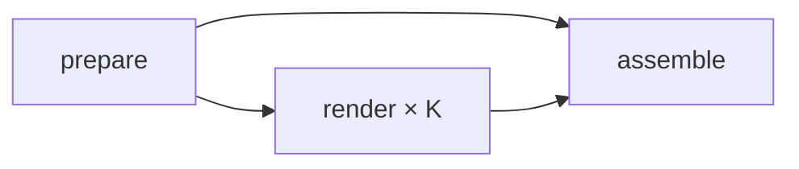

# GitHub Actions 分段渲染

在 Actions 的 **Render video → Run workflow** 填入项目目录即可。工作流需要先合入默认分支才能出现在手动触发入口。
运行前须配置仓库 secret `SENSITIVE_WORDS`（多行词表），并提交约定的 `tools/check/sensitive.py`。
词表为空、检查脚本不存在或脚本返回非零，prepare 都会失败；不会上传未检查的产物。

## 每期清单

在 `<project>/work/render.json` 中提交：

```json
{"page":"film.html","audio":"audio_v2.py","name":"32bit-ms-timer","fps":30}
```

| 字段 | 约定 |
| --- | --- |
| `page` | 必填；work 内的相对 `.html` 路径，页面提供 `__ready / __pause / __seek / __duration / FILM` 和 canvas `#c` |
| `audio` | 必填；work 内的相对 `.py` 路径；从 work 执行 `python3 <audio> <完整时间线绝对路径> <输出 WAV 绝对路径>`，可读取同目录脚本 |
| `name` | 必填；成片文件名主体，只含字母、数字、点、下划线和短横线，以字母或数字开头 |
| `fps` | 默认 30；目前 CI 支持 1–120 的整数帧率 |

`project` 只允许仓库内的单个顶层目录。清单及资源解析后必须仍在对应目录内，禁止越界路径。
画布须遵守现有约定：基础尺寸 1920×1080，按 `devicePixelRatio` 缩放；合成时会核验最终尺寸。
依赖为 Node 22、Chrome、FFmpeg/ffprobe、Python 3.12 + numpy/scipy/Pillow。字体直接使用项目已提交的子集。
Node 使用提交的 `tools/render/package-lock.json` 和 `npm ci`；锁文件沿用了主工作目录现有依赖，未改 package.json。

## 输入、帧边界和时间线

| workflow 输入 | 默认值 | 约束 |
| --- | --- | --- |
| `project` | 必填 | 如 `2026-10-16-32bit-ms-timer` |
| `scale` | `2` | `1` 为 1080p；`2` 为 3840×2160 |
| `segments` | `10` | 1–20；总帧数不足时缩减实际 runner 数，不生成空段 |
| `to` | 空 | 正数且不超过 FILM.duration；空表示整片 |

唯一总帧数为 `N = floor(目标秒数 × fps)`（仅补偿浮点数表示的整帧误差）。不足一帧的请求直接失败。
第 i 段为 `[floor(i*N/K), floor((i+1)*N/K))`；相邻边界相同，首帧为 0，末尾为 N。
传入 renderer 的秒数由整数帧号除以 fps 得到；renderer 对整帧起点统一使用 `(startFrame+i)/fps`，避免分段浮点加法差异。
例如参考片 356 秒、30 fps，共 10,680 帧；10 段各 1,068 帧。前 4 秒分两段则为 `[0,60)`、`[60,120)`。

prepare 的 `timeline.json` 保留原始 `duration/scenes/captions/cues/chapters`，并添加：

```json
"render": {"fps":30,"scale":2,"totalFrames":120,"duration":4,"requestedDuration":4}
```

`duration` 仍表示源片时长，`render.duration` / `render.totalFrames` 表示这次产物。
这样配乐脚本始终收到完整场景和字幕，生成后再将 WAV 裁到 `N/fps`，包括未指定 `to` 时去掉配乐尾音。
不提前缩短时间线：参考片配乐会查找后半段场景，并用整段音乐进行归一化。即使 `to=4`，仍需合成完整配乐。
音轨规范为 48kHz、双声道 PCM WAV，合成阶段编码为 AAC，目标码率 320k；AAC 实际码率可随内容变化。

## Job 图与产物



| Job / 超时 | 输入 | 处理 | 输出 |
| --- | --- | --- | --- |
| prepare / 45 分钟 | dispatch 输入、render.json、项目、SENSITIVE_WORDS | 检查敏感词；导出时间线；整数帧规划；完整配乐再裁剪 | job outputs `matrix`、`name`；artifact `render-prepared`：plan.json、timeline.json、audio.wav |
| render / 330 分钟 | `fromJSON(needs.prepare.outputs.matrix)`、prepare artifact、同一提交 | 每段 `--encoder x264 --workers 2`，只输出画面；参数固定为 medium / CRF 17 / yuv420p、清单 fps | artifact `render-part-0000` 等，每个含 `part-0000.mp4` |
| assemble / 60 分钟 | prepare + 全部 render 成功、全部分段 | concat demuxer `-c copy`；AAC 混音、faststart；校验；FFmpeg 从成片抽字幕中点并调用 sheet.py | 成片 artifact `<name>-scale-<scale>` 内的 `<name>.mp4`；`<name>-preview` 内的 sheet_*.jpg 和 timeline.json |

matrix 设置 `fail-fast: false`、`max-parallel: 20`。任一分段失败，assemble 不执行；实际并发还受账号其他任务影响。
中间 artifact 保留 1 天；成片、拼图和时间线保留 7 天。MP4 上传使用 compression-level 0。
权限只有 `contents: read`，checkout 不保留 Git 凭证；secret 仅注入敏感词检查的单个 step。
输入经环境变量传递给脚本，不插入 shell 命令文本。

拼接前核验段文件集合、帧数、时长、分辨率和 H.264 参数（含 extradata 哈希），各段必须没有音轨。
ffconcat 明确写入每段 `frames/fps` 时长，避免 MP4 毫秒级容器时长逐段累积误差。
最终解码检查精确帧数及每一帧 PTS，检查视频/容器时长、音轨时长与时间线的 render 目标。
视频时间容差为 1ms；AAC 另允许 1024/48000 秒的尾部采样帧误差。不会用 `-shortest` 掩盖配乐不足。

`-c copy` 保证拼接及混音不再次编码视频。独立分段与整段 CRF 17 编码会使用不同参考帧、GOP 和码率决策，二者解码像素不保证一致。

## 本地抽帧

浏览器优先级为 `--chrome` > `CHROME_PATH` > 系统安装路径；CI 使用 `/usr/bin/google-chrome`。
抽帧和时间线导出都不探测、不启动 FFmpeg。

```bash
export CHROME_PATH=~/.cache/ms-playwright/chromium-1217/chrome-linux64/chrome
node tools/render/render_local.mjs 2026-10-16-32bit-ms-timer/work/film.html \
  --frames captions --out-dir /tmp/video-captions --scale 1
python3 tools/preview/sheet.py /tmp/video-captions /tmp/video-captions-sheet
node tools/render/render_local.mjs 2026-10-16-32bit-ms-timer/work/film.html \
  --frames 0,61.5,120 --out-dir /tmp/video-picked --scale 1
```

字幕须有 `t0/t1`，抽 `(t0+t1)/2`；时间须在 `[0,duration)` 内，相同时间去重。
默认文件名如 `f_0061.50.jpg`；两位小数重名时自动增加小数位，最后一个 `_` 后仍是时间标签，兼容 sheet.py。
抽帧串行执行，降低审阅导出时的内存消耗；`--workers` 仍用于视频导出。
请用独立的空输出目录，避免旧 JPEG 混进拼图。
CI 成片预览仅取 `render.duration` 内的字幕中点；截短片中没有字幕中点时改取首帧。长片每 6 张一张拼图。

## 本地复现整条流水线

以下命令从仓库根目录执行。先配置 SENSITIVE_WORDS 并具备检查脚本；不需要 GitHub 网络服务。

```bash
node tools/render/ci/pipeline.mjs check 2026-10-16-32bit-ms-timer
node tools/render/ci/pipeline.mjs prepare 2026-10-16-32bit-ms-timer /tmp/render-prepared 1 2 4
node tools/render/ci/pipeline.mjs render /tmp/render-prepared/plan.json 0000 /tmp/render-parts
node tools/render/ci/pipeline.mjs render /tmp/render-prepared/plan.json 0001 /tmp/render-parts
node tools/render/ci/pipeline.mjs assemble /tmp/render-prepared /tmp/render-parts /tmp/render-final
```

prepare 的参数顺序为 `project 输出目录 scale segments to`，整片时省略最后一个参数。
只规划、不合成音轨时可直接用已导出的时间线：

```bash
node tools/render/ci/plan_segments.mjs 2026-10-16-32bit-ms-timer \
  2026-10-16-32bit-ms-timer/work/timeline.json /tmp/plan.json --to 4 --scale 1 --segments 2
node tools/render/ci/concat.mjs /tmp/plan.json /tmp/render-parts /tmp/joined.mp4
# 末尾添加 audio.wav 参数即可混音。
```

`check` 是独立、不可跳过的 workflow 步骤；底层 prepare/规划/拼接脚本可供离线测试，不隐式接触 secret。
所有 CI 产物写到 RUNNER_TEMP，不改项目 work 里的时间线或媒体。
本地受限环境可设置 `RENDER_NO_SANDBOX=1`，pipeline 会把 `--no-sandbox` 传给 renderer；常规 CI 不禁用浏览器沙箱。

## 验证与资源估算

```bash
node tools/render/ci/plan_segments.test.mjs
export CHROME_PATH=~/.cache/ms-playwright/chromium-1217/chrome-linux64/chrome
RENDER_NO_SANDBOX=1 bash tools/render/ci/verify_local.sh /tmp/video-render-reference
```

verify_local 要求输出目录为空；会导出完整字幕的 JPEG/拼图，再渲染参考片 0–4 秒整片及两段，用本项目 concat 脚本拼接。
它对比两份解码帧数，提取边界前后 PNG 并写出 `boundary/pixels.json`。
整片与分段的像素差异记录为统计；原分段与拼接对应帧必须逐像素一致，否则失败。
本次实际结果、沙箱限制和产物路径见 [VALIDATION.md](VALIDATION.md)。

4 vCPU runner 选 2 个截帧页面，给 x264、JPEG 编码及 Chrome 主进程留出 CPU；同时限制 4K 画布和在途 JPEG 的内存。
原先按 CPU 核数自动选择的本机用法保持不变；CI 不使用 GPU/NVENC。
默认 10 段时每台渲染 1,068 帧。尚无云端实测，按复杂 4K 软件绘制 **0.5–3 帧/秒** 的规划假设，每段约 **6–36 分钟**，
加配乐、依赖安装、上传、最终解码和预览，整期暂估 **15–60 分钟**（不含排队）。实际速度以首次 `to=4` 测试日志校准。
330 分钟渲染超时给复杂段及较小 segments 留余量；它不保证单段全片在最慢机器上一定完成。

## 文件分工

- `../render_local.mjs`：原有视频/时间线导出；新增 JPEG 抽帧、CHROME_PATH、整帧采样、错误清理。
- `common.mjs`：清单/路径验证、子进程、ffprobe、Actions outputs。
- `frames.mjs`：字幕中点和标签文件名。
- `plan_segments.mjs`：整数帧规划及规划完整性检查，可独立运行。
- `pipeline.mjs`：check / prepare / render / assemble 入口。
- `concat.mjs`：无损拼接、混音和媒体校验，可独立运行。
- `plan_segments.test.mjs`：150 组采样覆盖及非法输入、字幕命名测试。
- `verify_local.sh`、`verify_pixels.py`：真实参考片复现和边界像素报告。
- 仓库 `.github/workflows/render.yml`：调度及 artifact 流转；参考片 `work/render.json`：该期配置。
